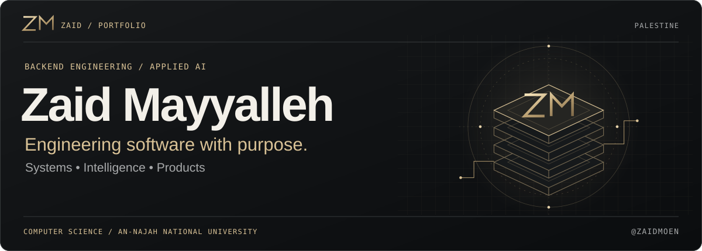
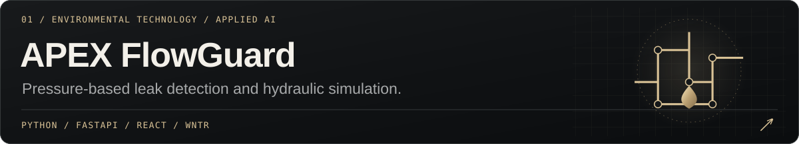
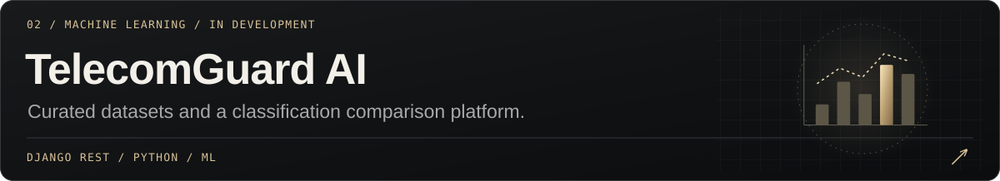
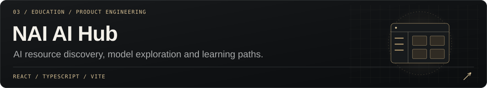
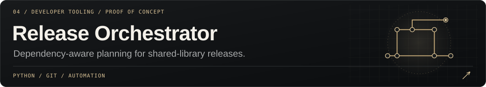
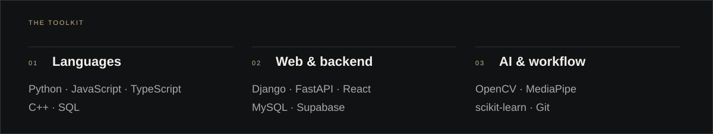
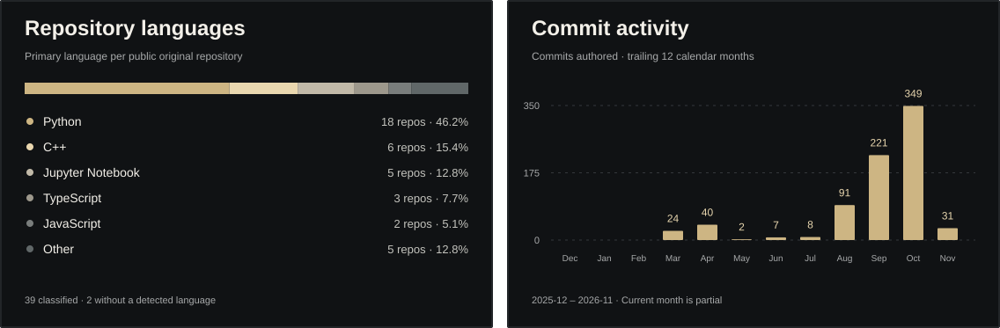

<picture>
  <source media="(max-width: 640px)" srcset="./assets/signature/hero-mobile.svg" />
  
</picture>

  <a href="#about">About</a> &nbsp; · &nbsp;
  <a href="#selected-work">Projects</a> &nbsp; · &nbsp;
  <a href="#technical-toolkit">Toolkit</a> &nbsp; · &nbsp;
  <a href="#github-activity">Activity</a> &nbsp; · &nbsp;
  <a href="https://www.linkedin.com/in/zaid-mayyalleh-307499376/">LinkedIn ↗</a>

## About

I'm **Zaid Mayyalleh**, a Computer Science student at An-Najah National University, Palestine, with a focus on backend engineering, applied AI and product development.

I enjoy turning complicated problems into software that is understandable, maintainable and useful — from APIs and data models to search engines, automation and intelligent applications.

| Focus | In practice |
| :--- | :--- |
| Backend engineering | APIs, relational databases, authentication and system design |
| Applied AI | Machine learning, information retrieval and decision-support systems |
| Technical leadership | Technical committee lead at NAI AI Association; backend training at Harri |

## Selected work

01 / SYSTEMS, INTELLIGENCE &amp; PRODUCTS

<a href="https://github.com/zaidmoen/apex-flowguard">
<picture>
  <source media="(max-width: 640px)" srcset="./assets/signature/flow-mobile.svg" />
  
</picture>
</a>

**[APEX FlowGuard](https://github.com/zaidmoen/apex-flowguard)** — Pressure-based leak detection and hydraulic simulation.

<a href="https://github.com/zaidmoen/telecomguard-ai">
<picture>
  <source media="(max-width: 640px)" srcset="./assets/signature/ml-mobile.svg" />
  
</picture>
</a>

**[TelecomGuard AI](https://github.com/zaidmoen/telecomguard-ai)** — Curated datasets and a classification comparison platform.

<a href="https://github.com/zaidmoen/nai-ai-hub">
<picture>
  <source media="(max-width: 640px)" srcset="./assets/signature/hub-mobile.svg" />
  
</picture>
</a>

**[NAI AI Hub](https://github.com/zaidmoen/nai-ai-hub)** — AI resource discovery, model exploration and learning paths.

<a href="https://github.com/zaidmoen/library-release-orchestrator">
<picture>
  <source media="(max-width: 640px)" srcset="./assets/signature/git-mobile.svg" />
  
</picture>
</a>

**[Release Orchestrator](https://github.com/zaidmoen/library-release-orchestrator)** — Dependency-aware planning for shared-library releases.

<strong>Explore more projects ↗</strong>

| Repository | Focus |
| :--- | :--- |
| [Employee Hub API](https://github.com/zaidmoen/employee-hub-api) | Layered Django backend for shifts, attendance and payroll |
| [NAI Membership System](https://github.com/zaidmoen/NAI-membership-system) | Student registration and administration |
| [IRForge](https://github.com/zaidmoen/IRForge) | Inverted indexing, Boolean and exact phrase search |
| [IR Logarithmic Merging](https://github.com/zaidmoen/IR-Logarithmic-Merging) | Dynamic inverted indexing in C++ |
| [Pinch Voxel Studio](https://github.com/zaidmoen/cube_builder) | Hand-tracked voxel editing with computer vision |
| [Bank Marketing ML](https://github.com/zaidmoen/bank-marketing-ml-classification) | Classification and model evaluation |

## Technical toolkit

02 / TOOLS BEHIND THE WORK

<picture>
  <source media="(max-width: 640px)" srcset="./assets/profile/stack-mobile.svg" />
  
</picture>

## GitHub activity

03 / A RECORD OF THE WORK

<a href="https://github.com/zaidmoen?tab=repositories">
<picture>
  <source media="(max-width: 640px)" srcset="./assets/stats/github-overview-mobile.svg" />
  
</picture>
</a>

<strong>Explore languages &amp; monthly activity</strong>

<picture>
  <source media="(max-width: 640px)" srcset="./assets/stats/github-details-mobile.svg" />
  
</picture>

Public data · Scheduled daily refresh · Language shares reflect repository counts, not proficiency. [Metric definitions](./docs/profile-maintenance.md#statistics).

## Let's connect

<picture>
  <source media="(max-width: 640px)" srcset="./assets/profile/connect-mobile.svg" />
  
</picture>

  <a href="mailto:zmayyalleh@gmail.com"><strong>Email ↗</strong></a> &nbsp; · &nbsp;
  <a href="https://www.linkedin.com/in/zaid-mayyalleh-307499376/"><strong>LinkedIn ↗</strong></a> &nbsp; · &nbsp;
  <a href="https://github.com/zaidmoen?tab=repositories"><strong>All repositories ↗</strong></a>

ZAID MAYYALLEH / ENGINEERING SOFTWARE WITH PURPOSE.

