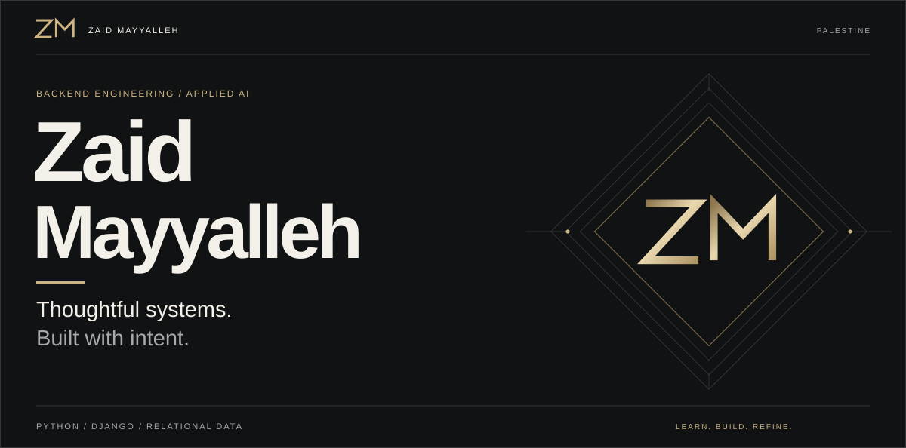
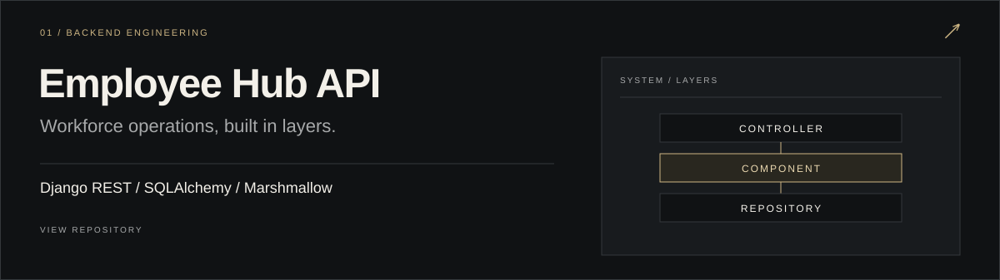
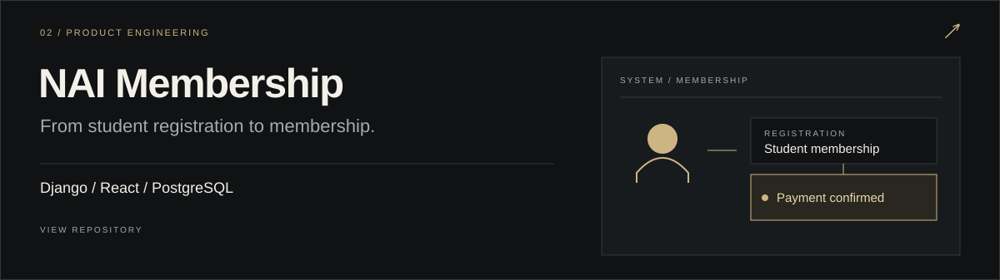
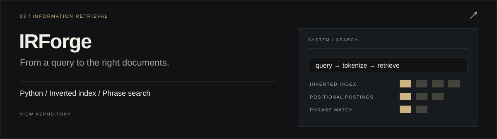
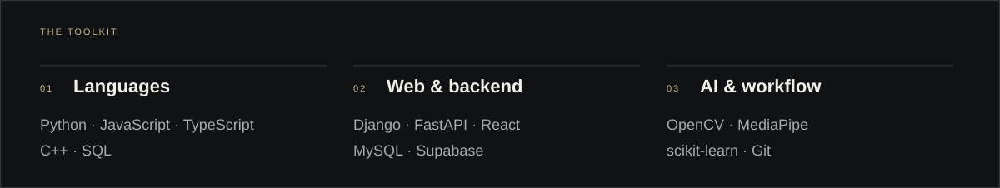
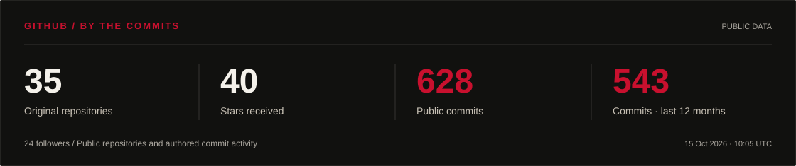
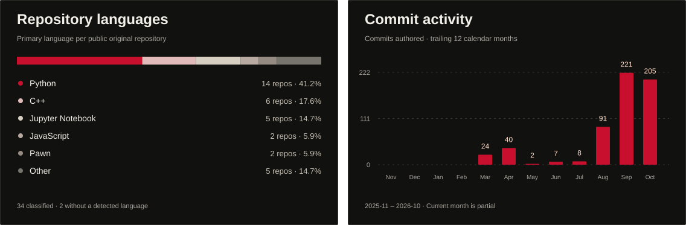

<picture>
  <source media="(max-width: 640px)" srcset="./assets/profile/hero-mobile.svg" />
  
</picture>

  <a href="#about-me">About</a> &nbsp; · &nbsp;
  <a href="#selected-work">Selected work</a> &nbsp; · &nbsp;
  <a href="#toolkit">Toolkit</a> &nbsp; · &nbsp;
  <a href="#github-activity">Activity</a> &nbsp; · &nbsp;
  <a href="https://www.linkedin.com/in/zaid-mayyalleh-307499376/">LinkedIn ↗</a>

 

## About me

I'm **Zaid Mayyalleh**, a Computer Science student at **An-Najah National University** in Palestine. I like building software where the details matter: a clear API, data that stays consistent, and an interface people can actually use.

- **Backend engineering:** Django, Python, relational data, authentication, and business rules.
- **In practice:** backend training at Harri and leading the technical committee at the NAI AI Association.
- **Beyond the API:** information retrieval, applied machine learning, and product ideas that move into working code.

 

## Selected work

01 / Selected systems. Practical problems.

 

<a href="https://github.com/zaidmoen/employee-hub-api">
<picture>
  <source media="(max-width: 640px)" srcset="./assets/featured/employee-hub-mobile.svg" />
  
</picture>
</a>

Controller → component → repository · Hourly rate history · Shift validation · Attendance and payroll

  

<a href="https://github.com/zaidmoen/NAI-membership-system">
<picture>
  <source media="(max-width: 640px)" srcset="./assets/featured/nai-membership-mobile.svg" />
  
</picture>
</a>

Public registration · Staff dashboard · Payment status · Django, React, and PostgreSQL

  

<a href="https://github.com/zaidmoen/IRForge">
<picture>
  <source media="(max-width: 640px)" srcset="./assets/featured/irforge-mobile.svg" />
  
</picture>
</a>

Tokenization · Positional postings · Boolean AND · Exact phrase queries

  

<strong>More from the workbench ↗</strong>

 

| Project | What it demonstrates |
| :--- | :--- |
| [IR Logarithmic Merging](https://github.com/zaidmoen/IR-Logarithmic-Merging) | A C++ dynamic inverted index with disk generations and streaming merges. |
| [Books Management API](https://github.com/zaidmoen/Books_manegment_MySQL) | A FastAPI and MySQL backend with JWT authentication. |
| [Pinch Voxel Studio](https://github.com/zaidmoen/cube_builder) | A hand-tracked voxel editor built with OpenCV and MediaPipe. |
| [Palestine Now](https://github.com/zaidmoen/palestine-now-web) | An Arabic-first local discovery demo with sample data. |
| [Bank Marketing ML](https://github.com/zaidmoen/bank-marketing-ml-classification) | Preprocessing, classification, and model evaluation. |

 

## Toolkit

02 / Tools behind the work.

 

<picture>
  <source media="(max-width: 640px)" srcset="./assets/profile/stack-mobile.svg" />
  
</picture>

 

## GitHub activity

03 / A record of the work.

 

<a href="https://github.com/zaidmoen?tab=repositories">
<picture>
  <source media="(max-width: 640px)" srcset="./assets/stats/github-overview-mobile.svg" />
  
</picture>
</a>

<strong>Explore languages &amp; monthly activity</strong>

 

<picture>
  <source media="(max-width: 640px)" srcset="./assets/stats/github-details-mobile.svg" />
  
</picture>

Public data · Scheduled daily refresh · Language shares use repository counts, not proficiency. <a href="./docs/profile-maintenance.md#statistics">Metric definitions</a>.

  

<a href="mailto:zmayyalleh@gmail.com">
<picture>
  <source media="(max-width: 640px)" srcset="./assets/profile/connect-mobile.svg" />
  
</picture>
</a>

  <a href="mailto:zmayyalleh@gmail.com"><strong>Email ↗</strong></a> &nbsp; · &nbsp;
  <a href="https://www.linkedin.com/in/zaid-mayyalleh-307499376/"><strong>LinkedIn ↗</strong></a> &nbsp; · &nbsp;
  <a href="https://github.com/zaidmoen?tab=repositories"><strong>All repositories ↗</strong></a>

ZAID MAYYALLEH &nbsp; / &nbsp; THOUGHTFUL SYSTEMS. BUILT WITH INTENT.

