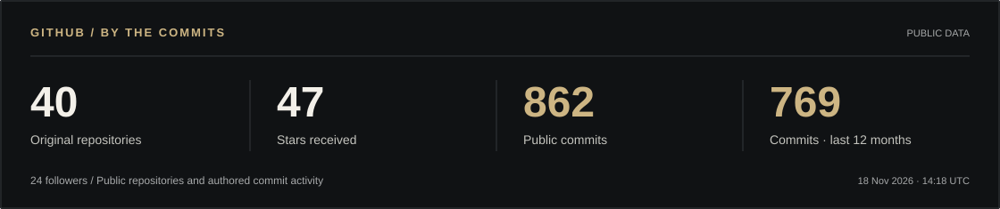

<picture>
  <source media="(max-width: 640px)" srcset="./assets/terminal/hero-mobile.svg" />
  
</picture>

<p align="center">
  <a href="#about">About</a> &nbsp; · &nbsp;
  <a href="#selected-work">Selected work</a> &nbsp; · &nbsp;
  <a href="#technical-toolkit">Toolkit</a> &nbsp; · &nbsp;
  <a href="#github-activity">Activity</a> &nbsp; · &nbsp;
  <a href="#contact">Contact</a>
</p>

## About

I'm **Zaid Mayyalleh**, a Computer Science student at An-Najah National University, Palestine, focused on backend engineering, applied AI and developer tooling.

I care about clear architecture, reliable systems and software that solves real problems. My experience includes backend training at Harri and technical committee leadership at NAI AI Association.

## Selected work

<sub>01 / PROJECTS &amp; SYSTEMS</sub>

<a href="https://github.com/zaidmoen/apex-flowguard">
<picture>
  <source media="(max-width: 640px)" srcset="./assets/terminal/flow-mobile.svg" />
  
</picture>
</a>

**[APEX FlowGuard](https://github.com/zaidmoen/apex-flowguard)** — Leak detection & hydraulic decision support.

<a href="https://github.com/zaidmoen/telecomguard-ai">
<picture>
  <source media="(max-width: 640px)" srcset="./assets/terminal/ml-mobile.svg" />
  
</picture>
</a>

**[TelecomGuard AI](https://github.com/zaidmoen/telecomguard-ai)** — Telecom churn & ML model comparison platform.

<a href="https://github.com/zaidmoen/nai-ai-hub">
<picture>
  <source media="(max-width: 640px)" srcset="./assets/terminal/hub-mobile.svg" />
  
</picture>
</a>

**[NAI AI Hub](https://github.com/zaidmoen/nai-ai-hub)** — AI resource discovery, model arena & learning paths.

<a href="https://github.com/zaidmoen/library-release-orchestrator">
<picture>
  <source media="(max-width: 640px)" srcset="./assets/terminal/git-mobile.svg" />
  
</picture>
</a>

**[Library Release Orchestrator](https://github.com/zaidmoen/library-release-orchestrator)** — Dependency-aware planning for shared-library releases.

<details>
<summary><strong>Explore more projects ↗</strong></summary>

| Repository | Focus |
| :--- | :--- |
| [Employee Hub API](https://github.com/zaidmoen/employee-hub-api) | Layered Django backend for shifts, attendance and payroll |
| [NAI Membership System](https://github.com/zaidmoen/NAI-membership-system) | Student registration and administration |
| [IRForge](https://github.com/zaidmoen/IRForge) | Inverted indexing, Boolean and exact phrase search |
| [IR Logarithmic Merging](https://github.com/zaidmoen/IR-Logarithmic-Merging) | Dynamic inverted indexing in C++ |
| [Pinch Voxel Studio](https://github.com/zaidmoen/cube_builder) | Hand-tracked voxel editing with computer vision |
| [Bank Marketing ML](https://github.com/zaidmoen/bank-marketing-ml-classification) | Classification and model evaluation |

</details>

## Technical toolkit

<sub>02 / TECHNOLOGIES &amp; PRACTICE</sub>

<picture>
  <source media="(max-width: 640px)" srcset="./assets/terminal/toolkit-mobile.svg" />
  
</picture>

## GitHub activity

<sub>03 / ENGINEERING ANALYTICS</sub>

<a href="https://github.com/zaidmoen?tab=repositories">
<picture>
  <source media="(max-width: 640px)" srcset="./assets/stats/github-overview-mobile.svg" />
  
</picture>
</a>

<picture>
  <source media="(max-width: 640px)" srcset="./assets/stats/github-details-mobile.svg" />
  
</picture>

<sub>Public metrics only · Daily refresh · Monthly activity excludes private repos and forks and reflects default-branch commit history. <a href="./docs/profile-maintenance.md#statistics">Metric definitions</a>.</sub>

## Contact

```text
❯ connect --collaborate
  Open to internships, junior roles and engineering collaboration.
```

<p align="center">
  <a href="mailto:zmayyalleh@gmail.com"><strong>Email ↗</strong></a> &nbsp; · &nbsp;
  <a href="https://www.linkedin.com/in/zaid-mayyalleh-307499376/"><strong>LinkedIn ↗</strong></a> &nbsp; · &nbsp;
  <a href="https://github.com/zaidmoen?tab=repositories"><strong>Repositories ↗</strong></a>
</p>

<p align="center"><sub>RELIABLE SOFTWARE, DESIGNED WITH INTENT.</sub></p>
